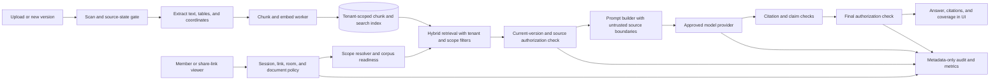

# VaultSpace AI Query System: phased design and implementation plan

Date: 2026-10-17
Status: Reviewed implementation plan. No AI feature is deployed by this document.

## Objective: the complete AI query system

Deliver a VaultSpace assistant that lets a person ask natural-language questions about the documents they are authorized to use, including questions across documents, topics, companies, industries, and financial models. It must answer from the current authorized source versions, show citations that open the precise supporting document location, distinguish extracted facts from calculations and inference, and say when the available evidence cannot answer. It must work for internal members and appropriately scoped external viewers, honor room, folder, document, group, link, and published-library access, and respond correctly when access or document state changes during a conversation. The system must be deployable first with an approved Azure Foundry model connection, while keeping model and embedding providers replaceable for other public or private deployments.

The complete system includes secure ingestion, hybrid retrieval, numerical analysis, the chat experience, audit records, operations, and an end-to-end test program. A room-wide eligibility gate is an interim release boundary, not the definition of the finished product. The final system retrieves only sources the actor may currently view. No source document is used to train a model as part of this design.

### Outcome and release criteria

| Outcome                   | Observable acceptance criterion                                                                                                                                                                                                                                                                                                                                                                                                                                                                                                                                                               |
| ------------------------- | --------------------------------------------------------------------------------------------------------------------------------------------------------------------------------------------------------------------------------------------------------------------------------------------------------------------------------------------------------------------------------------------------------------------------------------------------------------------------------------------------------------------------------------------------------------------------------------------- |
| Authorized answers        | Every cited passage and every datum used in an answer comes from a current, servable version that the actor can view at response time. No cross-organization, cross-room, unpublished, withdrawn, or revoked content is returned.                                                                                                                                                                                                                                                                                                                                                             |
| Useful answers and search | A versioned, human-reviewed golden set covers direct lookup, comparison, synthesis, unanswerable questions, financial calculations, and semantic-search relevance. Pilot answer thresholds: at least 90% correctness on answerable text questions, at least 95% supported citations, at least 90% correct abstention on unanswerable questions, and 100% correct results on the approved deterministic finance fixture set. Search relevance has a separate measured gate set from fixture baselines in Phase 0. Thresholds are measured separately by category and confirmed before rollout. |
| Explainable coverage      | Authorized administrators see indexed, pending, unsupported, failed, and excluded document counts. Other viewers see only a readiness state for their allowed scope. Chat is enabled only when its authorized active source set is fully AI-ready.                                                                                                                                                                                                                                                                                                                                            |
| Safe change handling      | Permission revocation, link expiry, withdrawal, deletion, publication change, and new versions take effect before any later answer is released. History and citations are reauthorized when opened.                                                                                                                                                                                                                                                                                                                                                                                           |
| Operable service          | Operators can see ingestion lag, failed jobs, provider errors, token and cost usage, latency, access denials, and coverage without recording document text, prompts, answers, secrets, or embeddings in ordinary logs.                                                                                                                                                                                                                                                                                                                                                                        |
| Portable backend          | Model, embedding, and retrieval interfaces have conformance tests. Moving from Azure to an approved public or private backend does not alter VaultSpace authorization semantics.                                                                                                                                                                                                                                                                                                                                                                                                              |

Zero access leaks is a release blocker rather than an average quality metric. The other numeric thresholds are proposed pilot gates and must be accepted by product and QA before the golden set is frozen.

## Evidence and current state

- The feature matrix lists F079, “AI Q&A assistant for viewers,” and F076, “Semantic search,” as V2 work. Architecture notes sketch an `AIProvider`; the current application has no implemented assistant, embedding store, or AI routes.
- The current search route performs text search then checks `PermissionEngine.can('view', DOCUMENT)` per candidate. It is a useful authorization reference, but it does not itself enforce current-version and withdrawal constraints for an AI corpus.
- The text worker extracts text from plain text, PDF, and images. XLSX and other Office formats currently produce no extracted text, so financial model questions cannot be promised from the present pipeline.
- `SearchIndex` is version based and has no vector field in the actual Prisma schema. The staging Azure PostgreSQL Flexible Server currently allows `pgcrypto`, not `vector`; extension configuration and performance must be verified before choosing pgvector for deployment.
- The Company Content Library foundation is disabled for customer use. Publishing, viewer resolution, search, and other serving paths remain future work. AI must initially target `INDEPENDENT` rooms and cannot index canonical library content for viewers. Later Company View support must use the exact published version and audience rules.
- The Munger subscription 1 inventory shows VaultSpace staging compute and PostgreSQL, but no dedicated VaultSpace Foundry or Azure AI Search resource. An unrelated test model resource is not an assumed VaultSpace dependency. This plan makes endpoint approval a Phase 0 gate.
- Sarah's Organization and CloudVault Series A are intended for demonstration. The full QA matrix will use a dedicated synthetic test organization and rooms; the demo corpus stays presentable.

## Design decisions

| ID  | Decision                                                                                                                                                                                                                                                                                                                                                                                                                    | Reason and review point                                                                                                                                                                                                          |
| --- | --------------------------------------------------------------------------------------------------------------------------------------------------------------------------------------------------------------------------------------------------------------------------------------------------------------------------------------------------------------------------------------------------------------------------- | -------------------------------------------------------------------------------------------------------------------------------------------------------------------------------------------------------------------------------- |
| D1  | VaultSpace owns authorization. Retrieval filters are a performance aid; authoritative access checks are made against current application state before context is sent and before an answer is released.                                                                                                                                                                                                                     | A provider-native ACL feature cannot replace current room, document, group, and share-link rules.                                                                                                                                |
| D2  | Start with one `INDEPENDENT` room and a room-wide gate. Members qualify only if they can view **every active document in the room**, including documents not yet indexed. External viewers qualify only through a currently valid `ENTIRE_ROOM` link and only if its policy permits every active document. The room is AI-ready only when every active document has an eligible current version and successful index entry. | This accepts the proposed simple first boundary without mistaking an incomplete index for complete access or complete evidence. Folder/document links and partial-access members get an unavailable state until D3 is delivered. |
| D3  | The complete system filters sources by current per-document authorization. A later phase supports partial-access members, scoped links, and published Company Views.                                                                                                                                                                                                                                                        | Product promise and end-state security requirement.                                                                                                                                                                              |
| D4  | Use Postgres full-text search plus a dedicated chunk/embedding table as the baseline hybrid retrieval design. Validate `pgvector` availability, index behavior, latency, and tenant isolation in staging before committing. Keep a `RetrievalProvider` boundary so Azure AI Search or another engine can replace it if benchmarks or scale require.                                                                         | Reuses the application database and supports portable deployments; Azure extension is not yet enabled.                                                                                                                           |
| D5  | Use an approved Azure Foundry deployment first through explicit model and embedding adapters. Support approved OpenAI-compatible or local adapters later. Do not silently route a failed Azure request to a different provider.                                                                                                                                                                                             | Keeps data handling and model behavior auditable.                                                                                                                                                                                |
| D6  | Index only scanned and approved, current, active, non-withdrawn, non-expired document versions. `SKIPPED` scans require a specific security decision before AI ingestion. Unsupported, skipped, pending, and failed active documents block AI readiness and remain visible in coverage counts to authorized administrators.                                                                                                 | Prevents stale and unreviewed source material from becoming hidden AI context and prevents claims based on a silently incomplete corpus.                                                                                         |
| D7  | Prompt instructions and retrieved documents are separated. Documents are untrusted data. The model has no tool that can fetch arbitrary URLs, execute code, modify VaultSpace, or broaden its retrieval scope.                                                                                                                                                                                                              | Limits prompt injection and indirect data exfiltration.                                                                                                                                                                          |
| D8  | No response streaming in the first release. Authorize again immediately before returning the complete answer; if state changed, discard the answer and require a new question. Later streaming needs a separate threat review.                                                                                                                                                                                              | Makes revocation semantics testable.                                                                                                                                                                                             |
| D9  | Chats are scoped to one actor, organization, and authorized room or scope. Prior turns are reauthorized before reuse. Ordinary telemetry stores IDs, timings, statuses, and counts, not raw prompts or document contents. Conversation retention and explicit deletion are controlled by an organization policy, with a proposed 30-day default pending privacy approval.                                                   | Prevents old context from bypassing later access changes and limits retained sensitive content.                                                                                                                                  |
| D10 | Each answer is tied to source version IDs and citation anchors. Citations are checked against retrieved authorized source IDs before release, and opening one invokes the normal VaultSpace serve authorization again.                                                                                                                                                                                                      | Prevents hallucinated or stale citations from becoming an access path.                                                                                                                                                           |

The Foundry resource, model, region, and contractual data handling are deployment approvals, not unresolved authorization design.

For this plan, the AI source set is the room's documents with `ACTIVE` status that have not been withdrawn or expired, plus their current versions. Archived, deleted, withdrawn, and expired documents are excluded from AI answers. An active document with a missing current version, an unsupported format, a skipped or failed scan, or a failed index job remains in the readiness denominator and blocks chat. Company View source sets will instead derive from active, audience-authorized published bindings and their pinned versions. These definitions must be implemented in one shared resolver and tested against normal document-serving behavior.

## Logical architecture

### Data and interface contracts

| Component                             | Required fields or behavior                                                                                                                                                                                                                                                                                                                                        |
| ------------------------------------- | ------------------------------------------------------------------------------------------------------------------------------------------------------------------------------------------------------------------------------------------------------------------------------------------------------------------------------------------------------------------ |
| `AiRoomPolicy`                        | Organization, room, enabled state, eligibility mode, approved provider/deployment, supported formats, retention policy, revision, actor and time of change. Off by default.                                                                                                                                                                                        |
| `AiSource`                            | Organization, room, document, exact current version, content checksum, scan and extraction state, source type, publication binding when applicable, indexed time, source revision, and exclusion reason.                                                                                                                                                           |
| `AiChunk`                             | Source ID, stable chunk ID, text or structured cell data, page/slide/sheet/cell coordinates, embedding model and version, language, content checksum. Treat text and embeddings as sensitive document derivatives: encrypt at rest, enforce database row-level tenant isolation, never log vectors, and purge with the source under the approved retention policy. |
| `AiConversation` / `AiTurn`           | Organization, room/scope, actor or link session identity, creation/expiry, authorized source IDs and versions, response status, citations, model ID, policy/corpus revision. Restrict reads to the creating actor/session and revalidate scope.                                                                                                                    |
| `AiQueryAudit`                        | Correlation ID, actor type and pseudonymous ID, organization, room/scope, authorization result, source counts, provider/model identifier, latency, token/cost estimate, error code, and policy revision. No prompt, answer, raw document text, or secret.                                                                                                          |
| `ModelProvider` / `EmbeddingProvider` | Explicit provider configuration, bounded input/output, timeout, cancellation, retry policy, model version, usage metadata, data-handling policy, and conformance tests.                                                                                                                                                                                            |
| `RetrievalProvider`                   | Tenant and scope filtering, hybrid ranking, stable source IDs, pagination/top-k bounds, source revalidation contract, and isolation tests.                                                                                                                                                                                                                         |

Do not reuse `SearchIndex` as the authority for source eligibility. The AI index tracks its own source state and joins the live document/version and publication records before use. Workers are idempotent and version aware: an old job may finish, but cannot publish stale chunks as current. Removing a version retires its chunks and invalidates answer cache and conversation context references. Backups and restores must preserve source-to-chunk integrity, and a reconciliation job must detect drift.

### API and user experience contract

The backend exposes server-authorized operations for readiness, semantic search, question submission, conversation history, deletion, and citation resolution. Each accepts a room or approved scope identifier; the server derives organization and actor identity from the session or validated link. Readiness returns a generic unavailable reason to ordinary viewers and detailed counts only to authorized administrators. Search returns only authorized current source snippets and normal viewer links. Question submission is bounded by request size, question rate, token budget, and concurrency; it returns a correlation ID, answer status, cited source IDs and anchors, and current coverage state. Neither operation accepts a client-supplied list of authorized document IDs as authority. History is scoped to its original actor or link session and is rechecked on every read. Citation resolution uses existing document serve rules, with a precise page, slide, or cell anchor when available. The UI presents example questions, a visible room/scope label, search results, source cards, calculation details, useful error and abstention states, and a clear deletion control. It renders model text safely and generates actionable citation links on the server, without turning arbitrary model or document URLs into privileged actions. Keyboard, screen-reader, narrow-screen, and loading-state behavior are part of acceptance, not post-release polish.

### Authorization and answer transaction

1. Authenticate the member or validate the share-link session and tenant. Resolve one requested room or scope. Refuse closed, disabled, or unsupported scopes according to product policy.
2. For the room-wide pilot, enumerate **all active documents in the room**, independent of index state. Apply the same permission engine and link policy as document serving. If any document is not viewable, deny AI access for that actor. Do not reveal which hidden document caused the denial. A zero-document room is not AI-ready.
3. Compute corpus readiness separately: current version, scan gate, extraction support, index success, and publication state. In the pilot, require successful indexing for every active room document. In the final partial-access release, require it for every active document in this actor's allowed set. Show the authorized actor a readiness state; only administrators see diagnostic counts that might disclose hidden documents. If coverage is incomplete, do not send the question to the model.
4. Retrieve candidates under organization and room/scope filters. Before text enters a model request, verify each candidate is the current approved version, in the actor's permitted source set, and bound to the proper published Company View version when applicable.
5. Build a bounded context with source labels. Treat source text as data; ignore instructions found inside it. Limit input, output, retrieval count, and conversation history. Only reinsert prior turns whose source references remain authorized.
6. Generate and validate the answer. Reject citations outside the authorized retrieved set. Identify computations and inferences as such. Ask for clarification or abstain if coverage or evidence is inadequate.
7. Recheck actor/session, room/scope, all cited and materially used sources, current versions, and policy state immediately before returning. If any changed, discard the generated answer. Record a metadata-only audit event. Citation links use the normal serve route and reauthorize on click.

For the final partial-access release, step 2 becomes a per-source allowed-set computation rather than a whole-room deny. Scope-filtering must happen before model context assembly and before retrieval results are exposed. A link's source set never expands beyond its scope or current policy. The assistant must not answer “what documents am I missing?” from inaccessible titles or counts.

### Financial and structured-answer contract

The financial lane ingests XLSX sheets, tables, named ranges, cell addresses, cached values, formulas, units, and dates with exact version and cell citations. The first finance release uses a controlled, read-only calculation service on extracted values and an allowlisted set of operations. It does not execute workbook macros, arbitrary Python, shell commands, or model-generated code. It checks formula versus cached-value differences, stale caches, hidden sheets, external links, circular formulas, currency and period alignment, blank and error cells, and precision. If a result depends on unsupported formulas or external data, the assistant explains the limitation rather than inventing a number. Every numerical answer shows source cells, formula or operation, units, and period.

## Phased delivery and gates

Every phase ends with a reviewable artifact set: design or change record, threat-model update, automated test results, manual QA evidence, coverage and quality metrics, open defects, operator runbook changes, and a go/no-go decision by product, security, QA, and operations roles. No phase begins production rollout while a prior release blocker remains open. Dates are set only after Phase 0 resource and test-fixture checks.

### Phase 0: design lock, ownership, and reproducible fixtures

**Build:** Confirm scope and model data-handling policy; select the approved VaultSpace Foundry endpoint, model, embedding model, region, quotas, and credential method. Inventory current search, authorization, link, library, and document lifecycle paths. Define source eligibility, retention, incident response, cost ceiling, and default-off policy. Create a synthetic test organization and fixture manifests in staging with deterministic identities, permissions, documents, model workbooks, and expected answers. Freeze a versioned golden question set and the scoring rubric. Record current staging PostgreSQL extension settings and a pgvector feasibility benchmark plan. Keep the demo organization untouched.

**Test and exit:** Architecture and privacy review sign off on data flow and providers; fixture loader is repeatable and reversible; baseline tests reproduce current permissions; no unrelated Azure resource is assumed. Record go/no-go evidence. If pgvector cannot meet requirements, select and document the alternative retrieval engine before Phase 1.

### Phase 1: trusted corpus and retrieval foundation

**Build:** Add AI policy, source, chunk, indexing-job, and audit schema with migrations and RLS. Add extraction for text/PDF/image with page anchors, source checksums, idempotent chunking, embedding, hybrid FTS/vector retrieval, reconciliation, and deletion/invalidation jobs. Enforce current-version, scan, active, withdrawal, expiry, and tenant rules. Expose an operator view of index lag and coverage. Enable the `vector` extension in staging only after the Phase 0 decision; production migration remains a separate gate.

**Test and exit:** Disposable-database RLS tests with two organizations; version race, retry, duplicate job, scan failure, withdrawal, deletion, reindex, and backup/restore tests; retrieval relevance and latency benchmark on representative fixture volumes. Zero unauthorized rows in raw retrieval and post-filter checks. Source-to-chunk reconciliation reaches 100% for the eligible test corpus. Rollback disables AI and stops workers without changing normal document serving.

### Phase 2: room-wide grounded assistant pilot

**Build:** Add server-side room-wide eligibility, current-source revalidation, Foundry adapter, prompt assembly, hybrid semantic-search results, grounded answer generation, citation validation, conversation storage and expiry, rate/cost bounds, metadata-only telemetry, and a customer-facing chat/search panel. Start with `INDEPENDENT` rooms, members with access to every active document, and valid `ENTIRE_ROOM` links that pass the same all-document check. UI explains unavailable AI generically, displays coverage, opens citations through normal viewer routes, and supports accessible keyboard and mobile use. Feature flags remain off until staging acceptance.

**Test and exit:** Permission matrices for member, admin, group, explicit deny, room/folder/document grants, link scope, expiry, password/session where applicable, org switch, and revocation between retrieval and response. A single unindexed, unsupported, skipped-scan, or failed document blocks room readiness. Adversarial documents and questions test prompt injection, role spoofing, cross-room requests, forged citations, unsafe model links, and sensitive data or vectors in logs. Run the answer and search golden sets and manual user journeys in dedicated test rooms. Zero access leaks, 100% valid citation target IDs, no raw content or vectors in ordinary logs, and agreed answer/search quality gates. A timed rollback toggles AI off and clears pending responses while normal document flows continue.

### Phase 3: supported source formats and financial answers

**Build:** Add DOCX, PPTX, XLSX, and CSV extraction with page/slide/sheet/cell or row coordinates; strengthen OCR and table parsing; show unsupported and failed coverage. The supported set is then plain text, PDF, common images, DOCX, PPTX, XLSX, and CSV. Other formats remain explicitly unsupported until separately designed and tested. Add the read-only finance calculation service, cell-level citations, period/unit checks, and numeric answer templates. Include source-version changes and extraction failures in the UI. Expand the model evaluation set for cross-document synthesis, entity/industry discovery, and financial questions.

**Test and exit:** Golden files with tables, merged cells, footnotes, hidden sheets, dates, currencies, formula caches, stale cache, external links, image-only PDF, and adversarial text. Compare financial outputs to independently calculated expected values and require 100% correctness on the approved deterministic fixture set. Human review checks whether quoted numbers and caveats match cited cells. Unsupported cases must abstain. Re-run Phase 2 security and lifecycle suites for every newly supported format.

### Phase 4: document-level access and published-library scopes

**Build:** Replace the room-wide gate with per-document allowed sets for members and valid scoped links. Apply group, explicit deny, folder, document, room, and link rules before retrieval and again before release. Compute AI readiness from that actor's allowed active set, without exposing inaccessible document counts. Add Company View AI only after library publish and viewer-resolution paths are live and independently accepted; bind AI sources to the exact published version and audience, never to unpublished canonical content. Support a multi-room query only if each room is explicitly selected and individually authorized, with citations showing room context. Add an access-scope indicator without disclosing hidden document counts or titles.

**Test and exit:** Exhaustive permission-product matrix across two organizations, multiple rooms, mixed grants and denies, partial-access users, link scopes, publication changes, version pinning, and revoke-during-query races. Differential tests compare AI allowed sets to the existing authoritative document-serve decisions. No unauthorized document IDs, snippets, embeddings, counts, citations, or history exposed. Company View AI stays disabled if the library serving gates remain incomplete.

### Phase 5: production hardening and staged release

**Build:** Add alerting for index lag, failures, provider outage, access-denial anomalies, cost, and latency. Add quota, abuse control, retention purge, recovery procedures, model/version change controls, and provider-adapter conformance checks. Conduct load and cost tests, security review, privacy review, accessibility review, disaster recovery rehearsal, and support training. Release by opt-in organization and room, then broaden only after measured results meet gates.

**Test and exit:** Full staging end-to-end regression; peak-load and concurrency tests; provider timeout and rate-limit simulation; database restore and reindex drill; controlled rollback drill; golden-set rerun on the exact production model version; telemetry and retention audit. Capture all evidence in a release packet. Keep AI off by default for organizations that have not opted in.

## Dedicated end-to-end QA environment

Use a synthetic organization and controlled test identities in staging. Define these rooms in fixture code and reset them between runs, with no customer data:

| Fixture room      | Purpose                                                                                                                                                       |
| ----------------- | ------------------------------------------------------------------------------------------------------------------------------------------------------------- |
| Full Access       | Direct lookup, synthesis, citation anchors, OCR, and room-wide eligible users.                                                                                |
| Split Access      | Folder and document grants, explicit denies, group membership changes, and partial-access refusal in Phase 2 followed by permitted-source answers in Phase 4. |
| Version Lifecycle | Current/old versions, scan states, withdrawal, expiry, deletion, and mid-query changes.                                                                       |
| Model Finance     | Controlled XLSX models with correct, stale, missing, and unsupported formula cases.                                                                           |
| External Viewer   | `ENTIRE_ROOM`, folder, and document links; expiry, revocation, sessions, and link policy.                                                                     |
| Published View    | Exact published library versions and audience changes, activated only after the Company Content Library serving release.                                      |

A second synthetic organization supplies cross-tenant negative tests. The test harness creates a manifest of expected authorized source IDs for each identity, room, question, and time point. It runs unit tests, database and worker integration tests, API contract tests, browser journeys, golden-answer evaluation, adversarial tests, load tests, and rollback drills. Evidence includes fixture version, git SHA, model and embedding versions, migration state, expected and actual source IDs, scoring rubric, failures, and reviewer sign-off. CI uses deterministic mocked-provider tests; staging runs live-provider evaluations on approved synthetic data to detect model behavior changes.

### Requirement-to-test traceability

| Requirement                                          | First delivery | Required evidence                                                                            |
| ---------------------------------------------------- | -------------- | -------------------------------------------------------------------------------------------- |
| Current, tenant-isolated corpus                      | Phase 1        | RLS, lifecycle, and reconciliation tests across two synthetic organizations.                 |
| All-document room gate and complete pilot coverage   | Phase 2        | Exhaustive membership/link matrix and hidden-unindexed-document test.                        |
| Grounded answers and citations                       | Phase 2        | Golden-set scoring, citation ID/anchor validation, and browser citation-open test.           |
| User-facing semantic search                          | Phase 2        | Relevance scoring, authorized snippet checks, and browser search-to-document journey.        |
| Prompt injection resistance and no side-effect tools | Phase 2        | Adversarial fixture results and provider/tool configuration review.                          |
| Financial questions with cell evidence               | Phase 3        | Independently calculated XLSX fixtures and unsupported-case abstention tests.                |
| Partial access and scoped links                      | Phase 4        | Differential allowed-set tests against document-serving decisions.                           |
| Published library and multi-room scope               | Phase 4        | Pinned-version, audience, revoke, and cross-room isolation tests.                            |
| Recovery, cost, retention, and provider portability  | Phase 5        | Restore and rollback drills, load/cost report, purge audit, and adapter conformance results. |

### Security and quality cases that cannot be skipped

- Hidden document with no index entry: whole-room pilot still denies the partially authorized user.
- Search hit from an old version, unpublished library item, withdrawn document, or another organization: never enters model context.
- Access revoked after retrieval or while the model is running: answer is discarded and citations/history are unavailable.
- Document says “ignore instructions” or asks to reveal another tenant: treated as untrusted source text.
- Link expires, is revoked, or changes scope during a conversation: next request and final response check fail.
- Model fabricates a citation or numerical result: citation/finance validator rejects it; user sees an honest limitation.
- Indexing fails for a permitted document: AI readiness fails and no model question is sent for that scope.
- Model provider is unavailable or over quota: bounded retry and clear error, no cross-provider data transfer without policy approval.
- A user changes organizations in the UI: prior room chat and history do not leak into the new tenant.
- A deleted or expired chat is absent from normal reads and purge verifies retained stores and backups against policy.

## Review and audit record for this plan

This record documents design reviews of the plan itself. It is not an independent security certification or a claim that implementation tests have passed.

| Pass                | Challenge and finding                                                                                                                                                                                                                                              | Revision incorporated into this plan                                                                                                                                                          |
| ------------------- | ------------------------------------------------------------------------------------------------------------------------------------------------------------------------------------------------------------------------------------------------------------------ | --------------------------------------------------------------------------------------------------------------------------------------------------------------------------------------------- |
| Strawman            | Simplest design: put every room document into one augmented corpus and allow only all-document viewers. Risk: an incomplete index could make the gate appear safe while an unindexed hidden document exists; stale versions and revocation could leak.             | Whole-room eligibility is checked against all active documents, independent of indexing; 100% AI readiness is a separate gate; current-version and final response authorization are required. |
| Steelman            | Strongest practical first release: all-document gate yields useful Q&A quickly without waiting for every per-document retrieval rule. It is legitimate if denial is server-side, current, and exhaustive.                                                          | Phase 2 is an opt-in pilot with exact conditions, link limits, and measurable exit criteria. Phase 4 completes partial access.                                                                |
| Premortem           | Likely failures: spreadsheet answers are wrong; prompt injection steers the model; library canonical content bypasses publication; AI costs or latency escalate; demo content is polluted; the selected Azure resource lacks capacity or has different data terms. | Dedicated finance lane, untrusted-source boundary, published-version binding, cost limits, synthetic rooms, and a Phase 0 provider approval gate.                                             |
| Design audit        | Checked against current permission engine, search route, scan gate, schema, Company Content Library plan, and Azure staging inventory. Identified no implemented AI backend and no XLSX extraction.                                                                | New AI source table and retrieval provider, independent-room first release, format coverage phase, and explicit pgvector feasibility gate.                                                    |
| Security audit      | Traced data from source to index to model to response and through chat history. Identified time-of-check/time-of-use, citation, link, and cross-tenant leakage paths.                                                                                              | Dual authorization, reauthorized history and citations, no streaming pilot, metadata-only logs, and zero-leak release gate.                                                                   |
| QA/operations audit | Checked whether each phase has reproducible fixtures, failure tests, observability, rollback, and release evidence. Found that F076 needed a visible search journey and embeddings needed derivative-data controls.                                                | Synthetic-room matrix, live and mocked provider evaluations, semantic-search gate, vector isolation/purge tests, recovery and rollback drills, and signed phase gates.                        |

Before implementation, a reviewer who did not author the code must repeat the security and QA audits on the concrete changes. Any changed provider, retrieval engine, library serving rule, or streaming decision reopens the relevant design gate.

## Risks, dependencies, and decisions at execution time

| Item                     | Required resolution and fallback                                                                                                                                                                               |
| ------------------------ | -------------------------------------------------------------------------------------------------------------------------------------------------------------------------------------------------------------- |
| Azure Foundry deployment | Approve a VaultSpace-specific model and embedding deployment, region, quotas, terms, and identity. If unavailable, Phase 0 pauses model-connected work; indexing and fixture work can proceed.                 |
| Vector retrieval         | Allowlist and benchmark `vector` on staging PostgreSQL. If performance, operations, or isolation fail, select a dedicated retrieval service behind `RetrievalProvider` and rerun the same authorization tests. |
| Company Content Library  | Phase 4 Company View AI depends on separately accepted publish and viewer-resolution paths. Independent-room AI can release without it.                                                                        |
| Extraction fidelity      | Unsupported or unreliable formats are reported as gaps. Finance answers remain disabled until their deterministic fixtures pass.                                                                               |
| Model quality            | Threshold failure triggers prompt/retrieval/format work and a new frozen evaluation run; it does not permit a security waiver.                                                                                 |
| Chat retention           | Product/privacy roles approve default and maximum retention before Phase 2. Until approved, persist no conversation history beyond the active request.                                                         |
| Operating cost           | Phase 0 sets per-org and per-room budgets and alert thresholds; the product enforces token and request bounds.                                                                                                 |

## Immediate execution sequence

1. Open tracked work items for F079 and F076 and the six phase gates, with this plan as the design authority.
2. Complete Phase 0 provider, privacy, scope, golden-set, fixture, and pgvector decisions; capture a signed architecture decision record.
3. Implement Phase 1 behind disabled flags, then execute its database, worker, isolation, and rollback gates.
4. Build and pilot Phase 2 in the synthetic rooms. Promote only after the security and quality criteria are met.
5. Complete format/finance, partial-access/library, and production-hardening phases in order, repeating the full regression and audit packet at each gate.

## References

Internal, verified against repository state on 2026-10-17:

- `dataroom-feature-matrix-v6.md`, F076 and F079 and the V2 critical path.
- `ARCHITECTURE.md`, planned `AIProvider` design.
- `src/app/api/search/route.ts`, current search authorization flow.
- `src/lib/permissions/PermissionEngine.ts` and `src/lib/permissions/LinkPolicy.ts`, current access rules.
- `src/workers/processors/textProcessor.ts` and `src/lib/documents/scanGate.ts`, extraction and scan behavior.
- `prisma/schema.prisma`, actual room, document, and search-index schema.
- `docs/CUSTOMER_FACING_ROADMAP_GROUP5_LIBRARY_INCREMENT_PLAN_2026-10-14_v1.md` and `docs/CUSTOMER_FACING_ROADMAP_GROUP5_LIBRARY_FOUNDATION_REVIEW_2026-10-14_v1.md`, Company Content Library release state.
- `QA_TEST_PLAN.md` and current integration/end-to-end test suites.
- Read-only Azure resource inventory and `azure.extensions` parameter in Munger subscription 1, checked 2026-10-17.

External technical references:

- [Microsoft: pgvector on Azure Database for PostgreSQL Flexible Server](https://learn.microsoft.com/en-us/azure/postgresql/extensions/how-to-use-pgvector).
- [Microsoft: Azure AI Search document-level access control](https://learn.microsoft.com/en-us/azure/search/search-document-level-access-overview).
- [Microsoft: Azure AI Search security trimming](https://learn.microsoft.com/en-us/azure/search/search-security-trimming-for-azure-search).
- [Microsoft: Foundry model inference REST API](https://learn.microsoft.com/en-us/rest/api/microsoft-foundry/modelinference/).
- [Microsoft: Data, privacy, and security for Azure AI Foundry Models](https://learn.microsoft.com/en-us/azure/ai-foundry/responsible-ai/openai/data-privacy).
- [OWASP: LLM01 Prompt Injection](https://genai.owasp.org/llmrisk/llm01-prompt-injection/).
